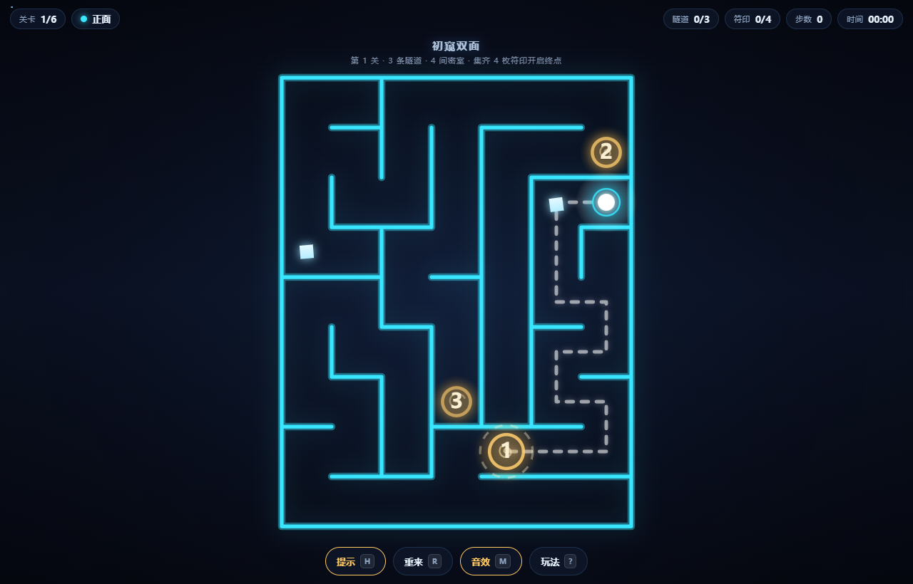
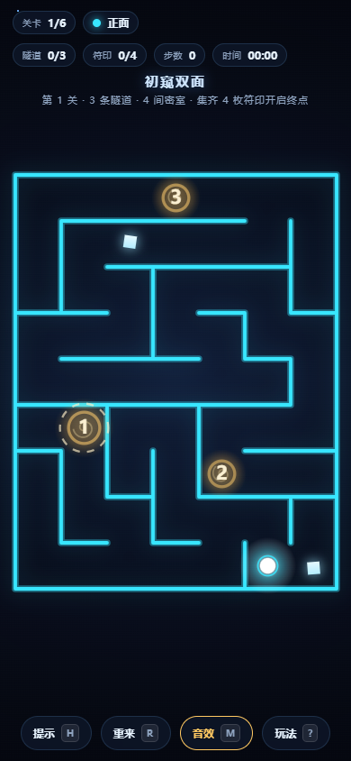

# 双面迷宫 · Dual-Face Maze

一座有**正面**和**背面**的迷宫。每条**隧道**都是一口**贯穿两面的竖井** —— 在正反两面落在**同一个格子**上，
从正面掉下去，就在背面的同一位置出来。你必须不断穿梭于正反两面，才能抵达终点。



---

## 一、玩法

| 概念 | 说明 |
|---|---|
| **两面** | 正面（青色墙）与背面（紫色墙），墙体布局完全不同，但共用同一套坐标网格 |
| **密室** | 每面迷宫被封成若干互相隔离的区域，区域内四通八达，区域之间只能靠竖井 |
| **竖井** | 编号的金色洞口，**正反两面开在同一个坐标**，编号即链路顺序 |
| **符印** | 每间密室一枚，收集全部符印后终点才会解锁 |
| **终点** | 只存在于背面的最后一间密室 |

### 核心机制：贯穿两面的竖井

关卡生成时，两面的密室被串成一条链：

```
正面A0 ──竖井1── 背面B0 ──竖井2── 正面A1 ──竖井3── 背面B1 ──竖井4── 正面A2 ──…
```

**每口竖井在正反两面是同一格**。所以：

- 玩家在正面踩到 3 号竖井，穿过去后**位置不变**，只是掉到了背面的同一格
- 正面与背面看到的 3 号竖井**在屏幕上完全对齐**，可以直接用眼睛对上号
- 画面上每口竖井外面套了一圈**双色半环**：左半是本面主色、右半是另一面主色，
  表示这口井在两面是同一个位置（上下贯穿）

- 每个**中间密室**恰好只有 **一个进、一个出** 两个洞口
- 因此竖井**必须按顺序穿**，一条都绕不过去
- 终点锁在链尾的最后一间密室里

这不是靠"看起来很难"实现的，而是由数据结构保证：
`tools/test-solvable.js` 用 **Dijkstra 在「双面 + 隧道」的联合图上**证明了
**到达终点最少也要穿越 `2k-1` 条隧道**（k = 每面密室数）。

### 关卡是怎么生成的

旧版是"两面各自随机切分 + 隧道两端各自取点"，两条隧道在两面会落在**不同格子**。
现在改成**先定竖井、再长密室**：

1. **竖井链**：在网格上生成一条 `2k-1` 格的**自避折线** `shaft[0..2k-2]`
   （相邻格相连、互不重复），竖井 `j` 固定落在 `shaft[j]`
2. **错位咬合**：正面第 i 间密室的种子是 `{shaft[2i-1], shaft[2i]}`，
   背面第 i 的是 `{shaft[2i], shaft[2i+1]}` —— 两面**错开一格**地共享同一批竖井格。
   于是 `shaft[j]` 在正反两面会落进**不同的密室**，房间图依旧是
   `A0–B0–A1–B1–…` 这样的简单路径，漏斗性质得以保留
3. **分区**：以每个密室的种子为源做多源随机边界扩张（`maze.js` 的 `growRegions`），
   保证区域连通、大小均衡
4. **雕刻**：先全封墙，再在每个区域**内部**跑 DFS 生成树；区域之间墙体全封死，
   所以"不穿竖井就到不了下一间密室"



---

## 二、操作

| 操作 | 桌面 | 移动端 |
|---|---|---|
| 移动 | `WASD` / 方向键 | 滑动 |
| 寻路 | 点击目标格（自动最短路） | 点击目标格 |
| 穿越隧道 | `空格` / `E` / `F` | 点「穿梭」按钮，或点自己所在格 |
| 路径提示 | `H` | 点「提示」按钮 |
| 重开本关 | `R` | 点「重来」按钮 |
| 音效开关 | `M` | 点「音效」按钮 |

提示功能会用 BFS 画出**到下一个隧道洞口**的路线（虚线）。

---

## 三、目录结构

```
maze/
├── index.html            # 入口（浏览器版，带 DOM HUD）
├── src/
│   ├── maze.js           # 【纯逻辑】迷宫生成 / 分区雕刻 / BFS 寻路
│   ├── game.js           # 【纯逻辑】关卡构建 / 竖井链 / 状态机
│   ├── render.js         # 【纯绘制】Canvas 2D 渲染，只依赖 2d context
│   └── main.js           # 【浏览器】引导：画布 / 输入 / HUD / 覆盖层
├── tools/
│   ├── test-solvable.js  # 无头验证：可解性 + 隧道链强制性
│   ├── test-shaft.js      # 无头验证：正反两面竖井「同位」专项
│   └── test-playthrough.js # 无头集成测试：用游戏自身 API 完整通关
├── docs/                 # 截图
└── README.md
```

**分层原则**（为小游戏移植预留）：

| 模块 | 依赖 | 小游戏里 |
|---|---|---|
| `maze.js` / `game.js` | 无 | **直接复用** |
| `render.js` | 仅 Canvas 2D Context | **直接复用**（微信/抖音小游戏都支持 `getContext('2d')`） |
| `main.js` | DOM、键盘、WebAudio | **需要重写**（小游戏无 DOM） |

三个核心模块都写成 UMD，既能 `<script>` 引入，也能在 Node 里 `require` 做无头测试。

---

## 四、跑起来 / 跑测试

```bash
# 任意静态服务器
python -m http.server 8811
# 打开 http://127.0.0.1:8811/index.html

# 无头测试（需 Node 18+）
node tools/test-solvable.js      # 结构 / 可解性 / 隧道链强制性
node tools/test-shaft.js         # 正反两面竖井「同位」专项（同格 / 不重复 / 咬合公式）
node tools/test-playthrough.js   # 完整通关 + 自动寻路 + 符印收集
```

---

## 五、移植到微信 / 抖音小游戏

小游戏没有 DOM、没有键盘、不能用 WebAudio，但**核心三个模块可以原样复用**。
下面是落地清单。

### 1. 目录改造

```
wechat-minigame/
├── game.js            # 入口：require 逻辑模块 + 调用适配层
├── game.json          # { "deviceOrientation": "portrait" }
├── project.config.json
└── src/
    ├── maze.js        # 原样拷贝
    ├── game.js        # 原样拷贝
    ├── render.js      # 原样拷贝
    ├── platform.js    # 【新写】平台差异适配
    └── ui.js          # 【新写】把 DOM HUD 改成 Canvas 绘制
```

抖音小游戏结构基本一致，只是入口是 `game.js` + `game.json`，包体上限 4MB（分包 20MB），比微信宽松。

### 2. 画布创建（两端 API 不同）

```js
// platform.js
function createMainCanvas() {
  // 微信：wx.createCanvas()   抖音：tt.createCanvas()
  const canvas = typeof wx !== 'undefined' ? wx.createCanvas() : tt.createCanvas();
  const info = typeof wx !== 'undefined'
    ? wx.getSystemInfoSync()
    : tt.getSystemInfoSync();
  const dpr = info.pixelRatio || 2;
  canvas.width = info.screenWidth * dpr;
  canvas.height = info.screenHeight * dpr;
  const ctx = canvas.getContext('2d');
  ctx.scale(dpr, dpr);              // 之后所有绘制都按 CSS 像素
  return { canvas, ctx, width: info.screenWidth, height: info.screenHeight, dpr };
}
```

`render.js` 只用 `ctx` 上的标准 2D API（`fillRect / createLinearGradient / arc / setLineDash` …），
**这段可以直接搬过去，不用改**。

### 3. 输入改造

| 需求 | 微信 | 抖音 |
|---|---|---|
| 触摸开始 | `wx.onTouchStart` | `tt.onTouchStart` |
| 触摸移动 | `wx.onTouchMove` | `tt.onTouchMove` |
| 触摸结束 | `wx.onTouchEnd` | `tt.onTouchEnd` |

`main.js` 里现有的 `touchstart/touchend` 逻辑（滑动方向 / 轻点寻路）可以直接复用，
只需把 DOM 事件换成平台事件，并把 `e.clientX/clientY` 换成 `e.touches[0].clientX/clientY`。

**键盘在两端都不可用**，所以移动端必须保证：
- 滑动移动 ✅ 已实现
- 点击格子自动寻路 ✅ 已实现
- 「穿梭」按钮 —— 需要在 `ui.js` 里用 Canvas 画一个可点击矩形（现在是 DOM 按钮）

### 4. HUD 必须重画成 Canvas

小游戏没有 DOM，顶部信息栏、底部按钮、开场/结算面板都要用 Canvas 绘制。
建议在 `ui.js` 里封装：

```js
UI.drawHud(ctx, state)      // 关卡 / 正反面 / 隧道 / 符印 / 步数 / 时间
UI.drawButtons(ctx, layout) // 提示 / 重来 / 音效 / 穿梭（返回命中区域数组）
UI.drawPanel(ctx, '过关', stats)  // 结算面板
```

命中检测用「点是否落在矩形内」即可，渲染层保留一份按钮矩形表：
`Render.layout()` 已经返回了 `ox/oy/cs/gw/gh`，把按钮坐标一起算出来就行。

### 5. 音频

当前用的是 WebAudio（`AudioContext`），**小游戏里不可用**。两种选择：

- **方案 A（推荐）**：砍掉音效。小游戏体量小，音效收益有限，省掉最省事。
- **方案 B**：改用平台音频 API
  ```js
  // 微信
  const audio = wx.createInnerAudioContext();
  audio.src = 'assets/step.mp3';
  audio.play();
  // 抖音
  const audio = tt.createInnerAudioContext();
  ```
  需要把 `Sound` 对象从"合成正弦波"改成"播放 mp3"。

### 6. 存档与分享（可选）

```js
// 微信
wx.setStorageSync('maze_progress', { level: 3, best: { s: 44, a: 48 } });
// 抖音
tt.setStorageSync('maze_progress', { level: 3 });
```

### 7. 其它注意事项

- **主循环**：两端都支持 `requestAnimationFrame`，可直接沿用。
- **横竖屏**：建议锁竖屏（`game.json` 里 `deviceOrientation: "portrait"`），双面迷宫竖屏观感更好。
- **性能**：最大关卡 13×17 = 221 格，墙体用了 `shadowBlur` 发光。小游戏低端机上建议把 `shadowBlur` 降到 0~6，或改用预渲染离屏 canvas。
- **包体**：纯代码 + 少量音频，整体远低于 4MB 限制。
- **翻转动画**：现在的翻面是「双面交叉溶解 + 光带 + 竖井光柱」，
  **网格不做位移**（因为竖井两面同格，镜像会导致玩家以为自己在别处）。
  移植到小游戏时保持这个逻辑即可 —— 别改回 `scaleX` 镜像。

---

## 六、扩展点

### 加关卡

改 `src/game.js` 里的 `LEVELS`：

```js
{ cols: 9, rows: 13, regions: 3, minSize: 9, name: '错层回廊' }
```

| 字段 | 含义 |
|---|---|
| `cols` / `rows` | 网格尺寸 |
| `regions` | **每面**要切出的密室数量（总隧道数 = `2 × regions - 1`） |
| `minSize` | 每个密室最少多少格，太小会切不出足够区域 |
| `name` | 关卡名 |

第 6 关之后会自动进入**无尽模式**（尺寸与密室数逐级增长），逻辑在 `main.js` 的 `levelDef()`。

### 改玩法参数

| 想改什么 | 改哪儿 |
|---|---|
| 移动动画时长 | `game.js` 的 `MOVE_DUR` |
| 翻转动画时长 | `game.js` 的 `FLIP_DUR` |
| 竖井链的形状 | `game.js` 的 `findShaftPath()`（自避折线的选点策略） |
| 两面密室的咬合方式 | `game.js` 的 `buildLevel()` 里 `seeds` 的分配 |
| 隧道是否必须按序 | `game.js` 的 `buildLevel()` 里隧道链的构造方式 |
| 终点是否要求集齐符印 | `game.js` 的 `checkGoal()` |
| 评级阈值 | `main.js` 的 `rankOf()` |

### 加新机制的想法

- **可推动的箱子 / 钥匙门**：在 `Maze` 上加一层动态格子状态
- **镜子面**：第三层迷宫，隧道连接三层
- **计时挑战**：无限模式 + 固定种子排行榜（`level.seed` 已经可复现关卡）
- **双色模式**：给正面/背面各加一种「可穿越的墙」，玩家需要按颜色顺序开门
